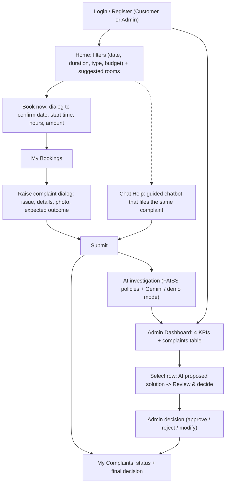

# AI-Powered Coworking Space Booking & Complaint Resolution System

An intelligent, beginner-friendly web application for booking coworking workspaces and resolving disputes through multimodal AI analysis and policy-grounded adjudication.

Built with **Streamlit**, **SQLite**, **Google Gemini**, **LangChain**, and **FAISS**.

---

## 🌟 Overview & Purpose

Managing coworking spaces requires balanced dispute resolution between guests and workspace hosts. This system streamlines:
1. **Workspace Discovery & Booking:** Search, filter, and reserve meeting rooms, cabins, desks, and studios with automatic pricing and conflict detection.
2. **Dispute Filing with Multimodal Validation:** Customers can report issues and upload photos. A Gemini vision-capable model checks whether the photo provides evidence for the reported issue (e.g., flagging unrelated photographs like a garbage bin for a Wi-Fi complaint).
3. **Evidence-Based Investigation with FAISS & LangChain:** Retrieves authoritative clauses from policy documents and objectively breaks disputes down into **Verified Facts**, **Customer Allegations**, **Owner Allegations**, and **Unknown Information**.
4. **Human-in-the-Loop Adjudication:** The AI proposes resolutions (Full Refund, Partial Refund, No Refund, or Manual Investigation). Human administrators make all binding financial decisions.
5. **Zero-Setup Demo Mode:** Works out-of-the-box even without a Google Gemini API key using deterministic simulation clearly labeled as demonstration results.

---

## 🛠️ Technology Stack

| Component | Technology | Purpose |
| :--- | :--- | :--- |
| **Language** | Python 3.11+ | Backend logic, data structures, and services |
| **Frontend UI** | Streamlit 1.50+ | Responsive, interactive, non-technical interface |
| **Styling** | Custom CSS | Professional design with clean typography and badges |
| **Database** | SQLite3 | Relational persistence with foreign keys and ACID transactions |
| **AI / LLM** | Google Gemini (1.5 Flash) | Vision understanding and dispute adjudication |
| **LLM Framework** | LangChain | Prompt engineering and policy context orchestration |
| **Vector DB** | FAISS | Vector indexing and semantic policy retrieval |
| **Image Verification** | Pillow (PIL) | Format validation, corruption checks, and resizing |
| **Data Validation** | Pydantic v2 | Type safety and structured AI output validation |
| **Security** | Werkzeug | Cryptographic password hashing (`generate_password_hash`) |
| **Testing** | pytest | Automated unit and integration test suite |

---

## 👥 User Roles & Access Control

The platform enforces strict backend authorization between two distinct user roles:

1. **Customer (`CUSTOMER`)**
   - Self-registration and login.
   - Browse spaces with live price calculations and conflict checks.
   - Manage personal reservations.
   - Submit complaints linked directly to bookings.
   - Upload evidence with instant AI relevance feedback.
   - Track complaint statuses and view final administrator decisions.

2. **Administrator (`ADMIN`)**
   - Dedicated login portal (no public self-registration).
   - High-level KPI control cards (Bookings, Complaints, Investigations, Manual Reviews).
   - Searchable, filterable dispute registry.
   - Single-page 6-section investigation dossier.
   - Human-in-the-loop controls: Approve, Reject, Modify, Request Evidence, or Escalate.

---

## 🔄 Application Workflow



---

## 🖥️ Screens

**Customer**
1. **Login / Register** — one page; pick *Customer* or *Admin* when logging in.
2. **Home** — filters for date, duration, space type and budget. Rooms that are free appear below as suggestions (cheapest first). **Book now** opens a dialog to confirm the start time, hours and amount.
3. **My Bookings** — every reservation with date, time, amount and amenities. **Raise complaint** opens a form: issue, details, optional photo, expected outcome.
4. **My Complaints** — the status of each complaint and the admin's final decision. (The AI recommendation is only visible to admins.)
5. **Chat Help** — describe the problem in your own words; the assistant picks the booking, suggests the category, asks for an optional photo and the outcome you want, then submits the same complaint. Ask it *"what's the status of my complaint?"* for a quick update.

**Admin**
- **Dashboard** — Total bookings, Total complaints, Under investigation, Manual review, and one table: Complaint ID, Booking ID, Customer ID, Customer, Space, Category, Amount, Status, **AI recommendation**, **Admin decision**. Select a row to read the AI's proposed solution, then **Review & decide** to approve, reject or modify it.

---

## 📂 Project Structure

```
coworking_ai/
|-- app.py                     # Main application entry point and session router
|-- requirements.txt           # Python dependencies
|-- .env                       # Local environment variables
|-- .env.example               # Template environment configuration
|-- .gitignore                 # Excludes database, uploads, secrets, and caches
|-- README.md                  # Comprehensive setup and user guide
|
|-- pages/
|   |-- auth_pages.py          # One screen: Login (customer/admin) + Create account
|   |-- home.py                # Filters, suggested rooms, booking dialog
|   |-- my_bookings.py         # Bookings list + "Raise complaint" dialog
|   |-- my_complaints.py       # Complaint status and final decision
|   |-- chat_assistant.py      # Guided chatbot that raises complaints
|   |-- admin_dashboard.py     # 4 KPIs + complaints table with AI recommendation
|   |-- dispute_details.py     # 6-section case investigation and decision console
|
|-- services/
|   |-- auth_service.py        # Werkzeug hashing and role enforcement
|   |-- booking_service.py     # Availability, free-slot search, pricing, conflicts
|   |-- chat_service.py        # Category detection and status replies for the chatbot
|   |-- complaint_service.py   # Complaint lifecycle and ownership verification
|   |-- image_validation_service.py # Pillow verification and upload handler
|   |-- gemini_service.py      # Google Gemini multimodal API and Demo Mode
|   |-- policy_service.py      # LangChain & FAISS vector search
|   |-- investigation_service.py # AI reasoning pipeline (Facts vs Allegations)
|   |-- generate_sample_assets.py # Generates synthetic demonstration graphics
|
|-- database/
|   |-- db.py                  # Thread-safe SQLite connection manager
|   |-- schema.sql             # SQL schema definitions and check constraints
|   |-- seed_data.py           # Pre-loaded spaces, bookings, and demo complaints
|
|-- models/
|   |-- schemas.py             # Pydantic schemas for requests and AI responses
|
|-- components/
|   |-- styles.py              # CSS styles, typography, and status badges
|   |-- navigation.py          # Role-based navbar and session router
|   |-- labels.py              # Display helpers (refund labels, amounts)
|   |-- complaint_form.py      # Complaint form (used in the dialog) with live image check
|
|-- knowledge_base/
|   |-- policies/              # Policy documents (Amenity, Access, Damage, Refund)
|
|-- vector_store/              # FAISS vector store cache directory
|-- uploads/                   # Uploaded customer evidence files
|-- sample_images/             # Demonstration space photos and evidence files
|
|-- tests/
|   |-- conftest.py            # Global test fixtures and database cleanup
|   |-- test_auth.py           # Authentication, hashing, and authorization tests
|   |-- test_bookings.py       # Pricing, booking creation, and conflict tests
|   |-- test_complaints.py     # Ownership and submission tests
|   |-- test_image_validation.py # Image mismatch and Pillow validation tests
|   |-- test_investigation.py  # FAISS retrieval and AI adjudication tests
|   |-- test_new_features.py   # Slot search, chatbot helpers, admin table data
```

---

## 🚀 Quick Start Guide

### 1. Clone & Set Up Virtual Environment

```bash
# Clone the repository
git clone https://github.com/your-username/coworking_ai.git
cd coworking_ai

# Create virtual environment (Python 3.11+)
python -m venv venv

# Activate on Windows:
venv\Scripts\activate
# Or on macOS/Linux:
source venv/bin/activate
```

### 2. Install Dependencies

```bash
pip install -r requirements.txt
```

### 3. Configure Environment Variables

Copy the `.env.example` file to `.env`:

```bash
cp .env.example .env
```

Edit `.env` to configure your settings:

```env
# Optional: Enter your Google Gemini API key.
# Leave blank to run in complete, self-contained DEMO MODE.
GOOGLE_API_KEY=your_gemini_api_key_here
GEMINI_MODEL=gemini-1.5-flash
GEMINI_EMBEDDING_MODEL=models/text-embedding-004

DATABASE_PATH=database/coworking.db
UPLOAD_DIRECTORY=uploads
MAX_UPLOAD_SIZE_MB=5
```

> [!NOTE]
> If `GOOGLE_API_KEY` is omitted or set to a placeholder, the system runs automatically in **DEMO MODE**. All booking and complaint features work without external API keys.

### 4. Initialize Database & Seed Demonstration Data

Run the seed script to create tables, sample spaces, bookings, policies, and demo complaints:

```bash
python database/seed_data.py
```

### 5. Build FAISS Policy Vector Store

```bash
python -c "from services.policy_service import build_faiss_index; build_faiss_index(force_rebuild=True)"
```

### 6. Run the Application

```bash
streamlit run app.py
```

The application will open in your browser at `http://localhost:8501`.

---

## 🔑 Pre-Configured Demonstration Accounts

| Role | Email | Password | Permissions |
| :--- | :--- | :--- | :--- |
| **Admin** | `admin@coworking.com` | `Admin@123` | Full dispute adjudication, KPI metrics, decisions |
| **Customer** | `alice@example.com` | `Password@123` | Bookings, complaints (Meeting Room A, Dedicated Desk) |
| **Customer** | `bob@example.com` | `Password@123` | Bookings, complaints (Executive Cabin 101) |
| **Customer** | `charlie@example.com` | `Password@123` | Bookings, complaints (Hot Desk Day Pass) |

---

## 🧪 Demonstration Cases Included

The database seeds four real-world dispute cases:

1. **Case 1: Projector Failure (`CMP-2026-001`)**
   - *Customer:* Alice Johnson | *Space:* Meeting Room A
   - *Issue:* Ceiling projector did not turn on for a client presentation.
   - *Evidence:* Photo of projector with unlit power light.
   - *AI Finding:* Projector is an advertised primary amenity. Recommends **`PARTIAL_REFUND` (50% = ₹750.00)** per Amenity Malfunction Policy Section 4.1.

2. **Case 2: Denied Access / Lockout (`CMP-2026-002`)**
   - *Customer:* Bob Smith | *Space:* Executive Cabin 101
   - *Issue:* Digital keypad lock rejected provided PIN code; reception was closed.
   - *Evidence:* Photo of smart lock displaying "Access Denied". Host admits changing code at noon.
   - *AI Finding:* Host changed code without confirmed receipt. Recommends **`FULL_REFUND` (100% = ₹2,400.00)** per Space Access Policy Section 2.1.

3. **Case 3: Wi-Fi Problem with Image Mismatch (`CMP-2026-003`)**
   - *Customer:* Charlie Davis | *Space:* Open Hot Desk Day Pass
   - *Issue:* Customer claims Wi-Fi was down all afternoon.
   - *Evidence:* Photo of a garbage bin.
   - *AI Finding:* **Image Mismatch Detected.** The photo shows waste disposal, not networking equipment. Host logs report 99.8% network uptime. Recommends **`MANUAL_INVESTIGATION`**.

4. **Case 4: Property Damage Dispute (`CMP-2026-004`)**
   - *Customer:* Alice Johnson | *Space:* Dedicated Desk #12
   - *Issue:* Host accuses customer of cracking an office chair armrest.
   - *Evidence:* Photo shows adhesive tape residue, suggesting pre-existing damage. Host did not take pre-check-in photos.
   - *AI Finding:* Conflicting accounts without pre-inspection photos. Mandates **`MANUAL_INVESTIGATION`** per Property Damage Policy Section 1.2.

---

## 🧪 Running Automated Tests

Run the full test suite with pytest:

```bash
pytest -v
```

All 37 tests run locally with mock data and require zero external API calls:
- Customer registration and validation
- Password hashing with Werkzeug
- Admin credential verification
- Cross-role access control enforcement
- Pricing math and capacity checks
- Overlapping booking conflict prevention
- Past date booking prevention
- Complaint ownership verification
- Duplicate complaint prevention
- Pillow image validation and corruption handling
- Unrelated image mismatch detection
- FAISS policy embedding and vector search
- Structured dispute investigation (Facts vs Allegations)
- Admin final decision recording and SQLite audit logs
- Free-slot search and fully-booked room handling
- Chatbot category detection and status replies
- Admin table data (AI recommendation never finalises a decision)

---

## ⚖️ AI Limitations & Human-in-the-Loop Governance

- **Advisory Only:** AI proposals never finalize financial refunds automatically.
- **Evidence Is Not Proof:** Photographs support an investigation but do not independently prove that an incident occurred during the booking.
- **Strict Distinction:** The AI separates verified database entries from unverified customer and host allegations.
- **Human Authority:** The human administrator reviews evidence, selects actions (Approve, Reject, Modify, Request Evidence, Escalate), enters a justification, and records the final decision.
